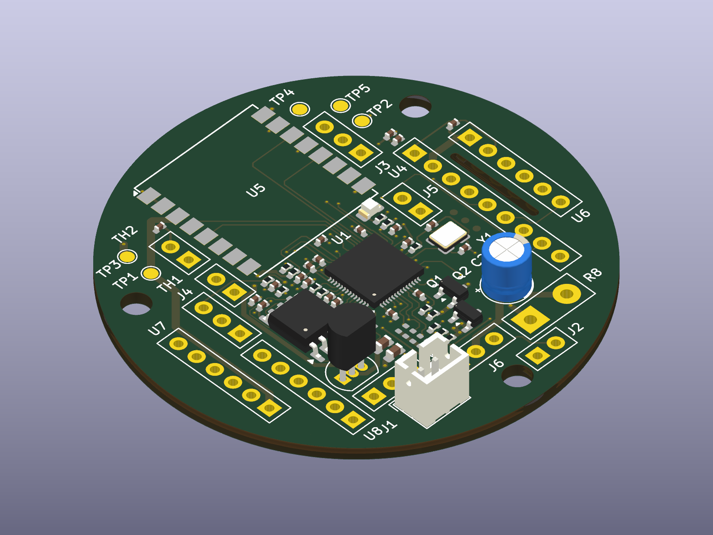
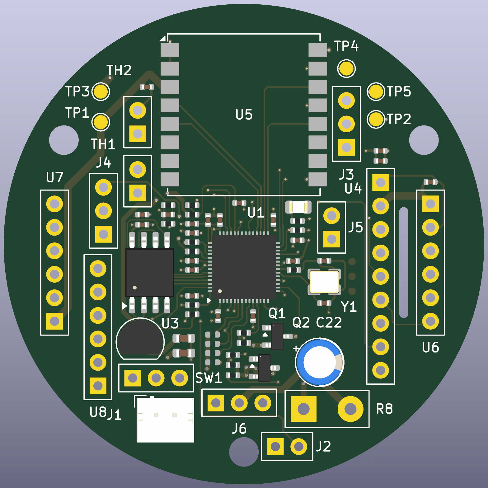
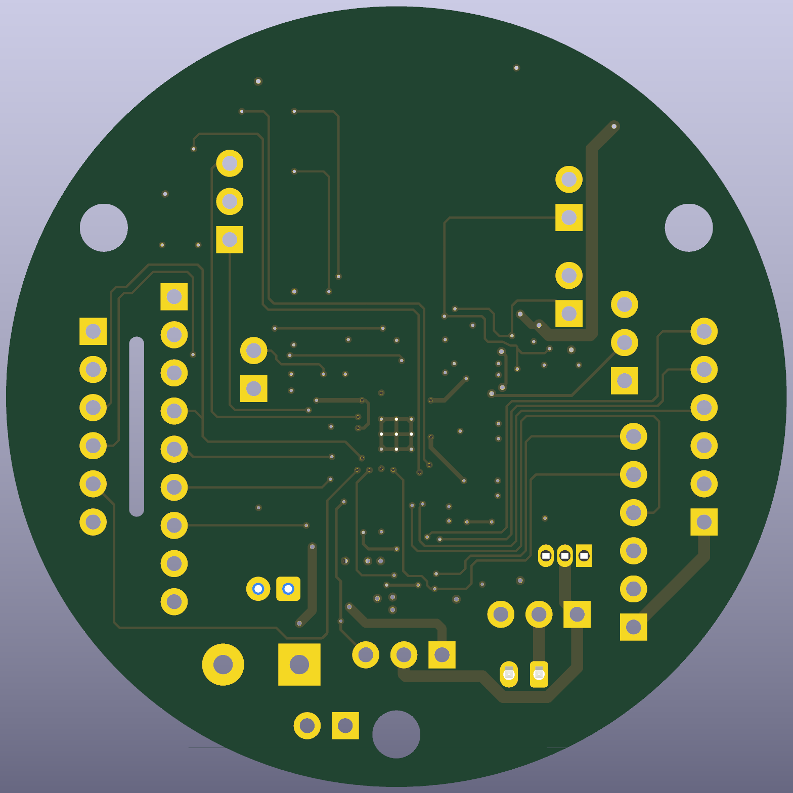

# CanSat — Team Verticality (RP2040 Avionics & Dinoflagellate Bioluminescence Payload)

[](https://kicanvas.org/?github=https%3A%2F%2Fgithub.com%2Fhuzi-ctrl%2FVerticality%2Fblob%2Fmain%2FCanSat.kicad_pcb)
[](./CanSat.kicad_pcb)
[](./DRC.rpt)
[](./LICENSE)

**Team Verticality** (Lancaster University School of Mathematics — UK CanSat Competition) is a 4-layer **52.0 mm round** avionics and dual-chamber biological payload controller built from scratch around the **Raspberry Pi RP2040** microcontroller.

Our secondary mission investigates **stress-induced mechano-bioluminescence** in marine dinoflagellates (***Pyrocystis fusiformis*** primary species; ***Pyrocystis lunula*** from Darwin Biological UK as the verified UK-stocked backup species) during rocket boost, parachute deployment, descent, and landing impact:
- **Chamber A (Warmed Experimental Culture)**: Actively maintained at **$22.0 \pm 1.0\text{ }^\circ\text{C}$** via a closed-loop PID controller driving an off-board $15\text{ }\Omega$, $2\text{ W}$ axial heating resistor (`R8`, switched by `Q1` `AO3400A` MOSFET at $1\text{ kHz}$ PWM) with a $10\text{ k}\Omega$ thin-film NTC thermistor (`TH1`). Safety cut-outs disable the heater if battery voltage drops below $3.50\text{ V}$ or Chamber A temperature reaches $30.0\text{ }^\circ\text{C}$.
- **Chamber B (Unheated Ambient Control)**: Identical optical geometry and cell concentration, left unheated with a matched $10\text{ k}\Omega$ NTC thermistor (`TH2`) to isolate temperature effects from mechanical shear and jerk ($\text{d}a/\text{d}t$).
- **Dual High-Sensitivity Optical Readout**: Two **AMS TSL2591** digital light sensor breakouts (`U7` on `I2C0`, `U8` on `I2C1` — separate hardware $\text{I}^2\text{C}$ buses because the `TSL2591` has a fixed `0x29` address) operating at $9876\times$ gain ($200\text{ ms}$ integration) inside light-tight black PETG chambers.
- **Pre-Touchdown Landing Leg Deployment & Upright Recovery**: Three 3D-printed curved landing legs folded against the **$64\text{ mm} \times 110\text{ mm}$** three-tier PETG cylindrical shell are released **during `DESCENT` before touchdown** — at **$150\text{ m}$ above pad altitude or $15\text{ s}$ after apogee, whichever comes first** — via an `MG90S` semi-metal servo (`J6`, low-side power-gated by `Q2` `AO3400A` so idle servo current is $0\text{ mA}$). The legs swing out to a **$140\text{ mm}$ triangular stance** while a $\sim 62\text{ g}$ steel ballast hatch lowers the centre of gravity to $z = 34\text{ mm}$ ($27\text{ mm}$ below the $61\text{ mm}$ leg pivot plane, giving a $>44^\circ$ static tip-over angle) so the top-mounted $433\text{ MHz}$ helical antenna stays upright after landing.

---

## 1. 3D PCB Renders & Layout Gallery

| Isometric 3D Render (`CanSat.kicad_pcb`) | Top View (`F.Cu` — RP2040, Flash, LDO, Ra-02, Power Stage) | Bottom View (`B.Cu` — Solid Ground Return & Signal Fanout) |
| :---: | :---: | :---: |
|  |  |  |

---

## 2. Mechanical Architecture, Landing Legs & Power Budget

### Three-Tier $64\text{ mm} \times 110\text{ mm}$ Shell & $52.0\text{ mm}$ Round PCB
The satellite body is a **$64\text{ mm}$ outer diameter $\times 110\text{ mm}$ tall** three-tier 3D-printed PETG structure clamped by **three $115\text{ mm}$ M3 A2 stainless steel threaded tie-rods** (`H1`, `H2`, `H3` on a $22.5\text{ mm}$ bolt-circle radius at $90^\circ, 210^\circ, 330^\circ$) to a top bulkhead lifting eyebolt:
1. **Top Tier ($40\text{ mm}$ height)**: Houses the **52.0 mm round 4-layer PCB**, the `Ai-Thinker Ra-02` ($433.175\text{ MHz}$ LoRa transceiver), U.FL pigtail, $21\text{ mm}$ helical antenna (`BW433SNX21-5W2`), `GY-BMP280-3.3` barometer (`U6`), and `Adafruit ADXL375` $\pm 200\text{ g}$ accelerometer (`U4`).
2. **Middle Tier ($42\text{ mm}$ height)**: Contains the light-tight black PETG **Chamber A** (heated to $22 \pm 1\text{ }^\circ\text{C}$ via `R8` $15\text{ }\Omega$ $2\text{ W}$ axial resistor and `TH1` NTC) and **Chamber B** (unheated control with `TH2` NTC), each with a sealed dinoflagellate vial and dedicated `TSL2591` optical sensor (`U7`, `U8`).
3. **Bottom Tier ($28\text{ mm}$ height)**: Houses the **flat `103450` $3.7\text{ V}$, $2000\text{ mAh}$ protected LiPo pouch cell** ($50 \times 34 \times 10\text{ mm}$ — selected specifically because a cylindrical 18650 cell is $65\text{ mm}$ long and cannot fit inside the $28\text{ mm}$ bottom tier or $64\text{ mm}$ diameter), the `MG90S` leg-release servo (`J6`), and the $\sim 62\text{ g}$ steel ballast hatch.

### Pre-Touchdown Leg Release Mechanism
- **Stowed Configuration**: Three curved 3D-printed PETG/TPU legs wrap flush against the outer wall during rocket integration and boost, held by a single nylon retention loop on the `MG90S` servo horn (`J6`).
- **In-Air Release (`STATE_DESCENT`)**: The flight software strictly locks out `Q2` (`GP9 = 0`) during `SELF_TEST`, `PAD`, and `BOOST`. Once apogee is passed (`STATE_DESCENT`) and either **relative altitude drops below $150.0\text{ m}$ above the pad OR $15.0\text{ s}$ have elapsed since apogee**, `GP9` turns on `Q2` (`AO3400A`) for $700\text{ ms}$ while `GP10` drives a $50\text{ Hz}$ PWM command to rotate the `MG90S` horn $120^\circ$, releasing all three legs before touchdown.
- **Self-Righting Geometry**: Torsion hinges open the three legs to a **$140\text{ mm}$ footprint** with hinges at $z = 61\text{ mm}$ above the base and the ballasted centre of gravity at $z = 34\text{ mm}$ ($27\text{ mm}$ below the pivot plane), providing a $>44^\circ$ static stability margin on uneven ground.

---

## 3. 4-Layer PCB Stackup, Layout Rules & Audit Compliance

The board ([`CanSat.kicad_pcb`](./CanSat.kicad_pcb)) is a **52.0 mm diameter**, $1.6\text{ mm}$ thick 4-layer FR-4 PCB designed to JLCPCB 4-layer manufacturing rules and verified against [`reports/CanSat_PCB_Design_Guide__Team_Verticality__rev2.pdf`](./reports/CanSat_PCB_Design_Guide__Team_Verticality__rev2.pdf):

| Layer | Copper Name | Plane / Function | Design Notes |
| :--- | :--- | :--- | :--- |
| **Layer 1** | `F.Cu` | Top Component & High-Speed Signal Layer | All **46 SMT components** placed on top side only (single-sided JLCPCB Economic PCBA); $90\text{ }\Omega$ differential USB (`R2`/`R3` = $22\text{ }\Omega$), short QSPI (`U2`), `12MHz` crystal (`Y1` + $33\text{ pF}$ C0G load caps `C10`/`C11`), and `0.6 mm` high-current switched paths (`Net-(Q1-D)` and `Net-(J6-Pin_1)`). |
| **Layer 2** | `In1.Cu` | Unbroken `GND` Reference Plane | Solid continuous ground reference plane beneath all high-speed, RF (`U5`), and analog (`ADC0..ADC2`) traces. |
| **Layer 3** | `In2.Cu` | `+3V3` Power Plane | Solid $+3.3\text{ V}$ distribution plane fed by `U3` (`MCP1700-3302E/TO`), with an explicit keepout cutout (`XTAL_KEEPOUT`) beneath `Y1`, `C10`, `C11`, and `R1` so crystal signals reference only `In1.Cu` (`GND`). |
| **Layer 4** | `B.Cu` | Bottom Signal Routing & `GND` Pour | Secondary signal fanout with stitched `GND` copper pour. Zero components on `B.Cu`. |

### Key Hardware & DFM Highlights
- **Strict SMT vs. Hand-Fit / Wire-Pad Separation**:
  - **46 SMT parts** (14 unique LCSC lines: 13 Basic + 1 Extended `RP2040` `C2040`, 157 SMT joints/board) have `LCSC` part numbers populated and are exported to [`production/parts_jlcpcb.csv`](./production/parts_jlcpcb.csv) and [`production/positions_jlcpcb.csv`](./production/positions_jlcpcb.csv).
  - **All 29 non-SMT items** — hand-fitted through-hole/castellated parts (`U3`, `U5`, `C22`, `J1`, `SW1`, `R8`), DNP $\text{I}^2\text{C}$ pull-up footprints (`R18–R21`), off-board module wire-pad groups (`U4`, `U6`, `U7`, `U8`, `TH1`, `TH2`, `J2`, `J3`, `J4`, `J5`, `J6`), test points (`TP1–TP5`), and mounting holes (`H1–H3`) — have **both `Exclude from bom` and `Exclude from Position Files`** set in [`CanSat.kicad_sch`](./CanSat.kicad_sch) and [`CanSat.kicad_pcb`](./CanSat.kicad_pcb).
- **High-Current MOSFET Via Arrays & Trace Widths**:
  - `Q1` (Heater `AO3400A`) and `Q2` (Servo `AO3400A`) each have **three `0.6 mm / 0.3 mm` `GND` vias** at their source pads (`Q1.2` and `Q2.2`) to handle the $\sim 1\text{ A}$ servo stall current and $250\text{ mA}$ heater current with minimal ground bounce.
  - `HighCurrent` netclass contains only the switched drain paths `Net-(Q1-D)` and `Net-(J6-Pin_1)` routed at **`0.6 mm` width**, while the logic gate nets (`/HEATER`, `/SERVO_P`, `/SERVO_S`) use signal widths.
- **Via Sizing & Standard JLCPCB $2.00 Base Tier Optimization**:
  - Every via on the board uses a **`0.30 mm` drill minimum** across all 112 vias (90 at `0.45 / 0.30 mm`, 3 at `0.50 / 0.30 mm`, and 19 at `0.60 / 0.30 mm` — zero `< 0.30 mm` vias remain), with `min_through_hole_diameter: 0.30` and `min_via_annular_width: 0.075` mm configured in [`CanSat.kicad_pro`](./CanSat.kicad_pro). This qualifies the design for JLCPCB's standard **`0.3mm / (0.4/0.45mm)`** pricing tier ($2.00 base price) instead of triggering advanced high-precision surcharges.
  - All 12 wire-pad groups (`J1/SW1`, `J2 BOOTSEL` using `CanSat_Modules:Pad_2pad_GND_SIG`, `J3 SWD`, `J4 USB`, `J5 RUN`, `J6 Servo`, `R8 Heater`, `TH1`, `TH2`, `U4`, `U6`, `U7`, `U8`) are protected by `WIRE_PADS` keepout zones prohibiting vias under solder pads, and teardrops are enabled on all pads and vias.
- **DRC & ERC Verification Status**:
  * [`DRC.rpt`](./DRC.rpt): **0 unconnected pads, 0 footprint errors, 0 schematic parity errors**.
  * **16 DFM Clearances Documented**:
    * **4 Hole-to-Hole Spacing Notices**: In the tight $0.4\text{ mm}$ pitch RP2040 escape fanout, adjacent $0.3\text{ mm}$ drill vias sit at $0.407\text{ mm}$ (`/INT_A` vs `/INT_B`) to $0.450\text{ mm}$ drill-edge spacing. While flagged against KiCad's generic $0.500\text{ mm}$ default rule, these safely clear JLCPCB's 4-layer CAM drill-to-drill capability of $\ge 0.25\text{ mm}$ (and $\ge 0.254\text{ mm}$ same-net).
    * **12 Drill-to-Track Clearances**: With $0.45\text{ mm}$ pads, $0.30\text{ mm}$ drills ($0.075\text{ mm}$ annular ring), and standard $0.15\text{ mm}$ trace clearance, physical drill-to-trace distance is $0.205\text{ mm} - 0.235\text{ mm}$, fully compliant with JLCPCB's 4-layer hole-to-track minimum of $\ge 0.20\text{ mm}$.
  * [`ERC.rpt`](./ERC.rpt): **0 ERC errors** (50 warnings for net-label wire stubs and unspecified pins per design guide).

---

## 4. Complete RP2040 Pin Allocation & Wire-Pad Pin Orders

### RP2040 (`U1`) GPIO & Peripheral Map

| RP2040 Pin | GPIO / Function | Schematic Net | Connected Component & Function |
| :---: | :--- | :--- | :--- |
| **Pin 2** | `GP0` (`UART0_TX`) | `/RX` | `TP4` UART Debug Header (MCU Transmit -> Adapter RX) |
| **Pin 3** | `GP1` (`UART0_RX`) | `/TX` | `TP5` UART Debug Header (MCU Receive <- Adapter TX) |
| **Pin 4** | `GP2` ( IRQ ) | `/INT_A` | `U7` (`TSL2591` Chamber A) Interrupt Output |
| **Pin 5** | `GP3` ( IRQ ) | `/INT_B` | `U8` (`TSL2591` Chamber B) Interrupt Output |
| **Pin 6** | `GP4` (`I2C0_SDA`) | `/SDA0` | `U7` (`TSL2591` Chamber A) $\text{I}^2\text{C}$ Data (`R18` DNP; pull-up on module) |
| **Pin 7** | `GP5` (`I2C0_SCL`) | `/SCL0` | `U7` (`TSL2591` Chamber A) $\text{I}^2\text{C}$ Clock (`R19` DNP; pull-up on module) |
| **Pin 8** | `GP6` (`I2C1_SDA`) | `/SDA1` | `U8` (`TSL2591` Chamber B) $\text{I}^2\text{C}$ Data (`R21` DNP; pull-up on module) |
| **Pin 9** | `GP7` (`I2C1_SCL`) | `/SCL1` | `U8` (`TSL2591` Chamber B) $\text{I}^2\text{C}$ Clock (`R20` DNP; pull-up on module) |
| **Pin 11** | `GP8` (`PWM4_A`) | `/HEATER` | `R7` ($100\text{ }\Omega$) & `R9` ($100\text{ k}\Omega$) $\rightarrow$ `Q1` (`AO3400A`) Gate $\rightarrow$ `R8` ($15\text{ }\Omega$ $2\text{ W}$ Chamber A Heater) |
| **Pin 12** | `GP9` (GPIO Out) | `/SERVO_P` | `R10` ($100\text{ }\Omega$) & `R11` ($100\text{ k}\Omega$) $\rightarrow$ `Q2` (`AO3400A`) Gate $\rightarrow$ `J6` (`MG90S` Low-Side Power Switch) |
| **Pin 13** | `GP10` (`PWM5_A`) | `/SERVO_S` | `R17` ($10\text{ k}\Omega$ pull-down) $\rightarrow$ `J6` Pin 3 (`MG90S` $50\text{ Hz}$ Servo PWM Signal) |
| **Pin 14** | `GP11` (`SPI1_CSn`) | `/PRESS_CS` | `U6` (`GY-BMP280-3.3`) SPI Chip Select |
| **Pin 15** | `GP12` (`SPI1_RX`) | `/IMU_MISO` | `U4` (`ADXL375`) & `U6` (`BMP280`) Shared `SPI1` MISO |
| **Pin 16** | `GP13` (`SPI1_CSn`) | `/IMU_CS` | `U4` (`ADXL375` $\pm 200\text{ g}$ Accelerometer) SPI Chip Select |
| **Pin 17** | `GP14` (`SPI1_SCK`) | `/IMU_SCLK` | `U4` (`ADXL375`) & `U6` (`BMP280`) Shared `SPI1` Clock |
| **Pin 18** | `GP15` (`SPI1_TX`) | `/IMU_MOSI` | `U4` (`ADXL375`) & `U6` (`BMP280`) Shared `SPI1` MOSI |
| **Pin 27** | `GP16` (`SPI0_RX`) | `/RA_MISO` | `U5` (`Ai-Thinker Ra-02` `SX1278` $433.175\text{ MHz}$ LoRa) MISO |
| **Pin 28** | `GP17` (`SPI0_CSn`) | `/RA_CS` | `U5` (`Ai-Thinker Ra-02`) NSS / Chip Select |
| **Pin 29** | `GP18` (`SPI0_SCK`) | `/RA_SCLK` | `U5` (`Ai-Thinker Ra-02`) SCK |
| **Pin 30** | `GP19` (`SPI0_TX`) | `/RA_MOSI` | `U5` (`Ai-Thinker Ra-02`) MOSI |
| **Pin 31** | `GP20` (GPIO Out) | `/RA_RESET` | `U5` (`Ai-Thinker Ra-02`) Hardware Reset |
| **Pin 32** | `GP21` (GPIO In) | `/RA_DIO0` | `U5` (`Ai-Thinker Ra-02`) `DIO0` TxDone / RxDone IRQ |
| **Pin 34** | `GP22` (GPIO In) | `/IMU_INT1` | `U4` (`ADXL375`) `INT1` High-G Shock Interrupt |
| **Pin 37** | `GP25` (GPIO Out) | `/LED` | `R12` ($1\text{ k}\Omega$) $\rightarrow$ `D1` (`KT-0805G` Green Status LED) |
| **Pin 38** | `GP26 / ADC0` | `/BATT_SENSE`| `R15` ($100\text{ k}\Omega$) / `R16` ($100\text{ k}\Omega$) $2:1$ Divider + `C25` ($100\text{ nF}$) from `/VBAT` |
| **Pin 39** | `GP27 / ADC1` | `/NTC_A` | `R13` ($10\text{ k}\Omega$ to `+3V3`) + `C23` ($100\text{ nF}$) + `TH1` (Chamber A $10\text{ k}\Omega$ NTC) |
| **Pin 40** | `GP28 / ADC2` | `/NTC_B` | `R14` ($10\text{ k}\Omega$ to `+3V3`) + `C24` ($100\text{ nF}$) + `TH2` (Chamber B $10\text{ k}\Omega$ NTC) |
| **Pin 46/47**| `USB_DM / USB_DP` | `/D-`, `/D+` | `R2` ($22\text{ }\Omega$) & `R3` ($22\text{ }\Omega$) $\rightarrow$ `J4` (`USB_3pad_wire`) |
| **Pin 51–56**| `QSPI_SD0..3, SCLK, SS` | `/SD0..3, /SCLK, /SS` | `U2` (`W25Q128JVSIQ` $16\text{ MB}$ QSPI Flash) + `R5` ($10\text{ k}\Omega$) + `R4` ($1\text{ k}\Omega$ to `J2` `BOOTSEL`) |

### Off-Board Wire-Pad Pin Orders (Design Guide Rev 2 Section 6)

| Footprint Ref | Module / Function | Pad Order on PCB |
| :---: | :--- | :--- |
| **`J1`** | Battery Input (`JST B2B-PH-K-S`) | `1 = /VBAT_R` (Battery $+$), `2 = GND` (Check LiPo red/black polarity before plugging in) |
| **`SW1`** | Master Slide Switch (`SS-12D00G3`) | `1 = open`, `2 = /VBAT_R` (middle common pin), `3 = /VBAT` (switched rail) |
| **`J2`** | `BOOTSEL` (`Pad_2pad_GND_SIG`) | `1 = GND`, `2 = Net-(J2-Pin_2)` (to `R4` $1\text{ k}\Omega \rightarrow \text{/SS}$) |
| **`J3`** | `SWD` (`SWD_3pad`) | `1 = /SWDIO`, `2 = GND`, `3 = /SWCLK` |
| **`J4`** | `USB` (`USB_3pad_wire`) | `1 = GND`, `2 = /D-`, `3 = /D+` (Board powered from battery during USB flashing) |
| **`J5`** | `RUN` (`Pad_2pad_GND_SIG`) | `1 = GND`, `2 = /RUN` |
| **`J6`** | `MG90S` Servo (`Pad_3pad_Servo`) | `1 = Net-(J6-Pin_1)` (switched GND via `Q2` — brown), `2 = /VBAT` (red), `3 = /SERVO_S` (orange) |
| **`R8`** | Chamber A Heater ($15\text{ }\Omega$ $2\text{ W}$) | `1 = Net-(Q1-D)` (switched GND via `Q1`), `2 = /VBAT` |
| **`TH1` / `TH2`** | Chamber A / B NTC ($10\text{ k}\Omega$) | `1 = /NTC_A` (or `/NTC_B`), `2 = GND` |
| **`U4`** | `ADXL375` Breakout (`Pad_7pad_ADXL375`) | `1/6 = +3V3`, `2/4/5 = GND`, `7 = /IMU_CS`, `8 = /IMU_INT1`, `12 = /IMU_MISO`, `13 = /IMU_MOSI`, `14 = /IMU_SCLK` |
| **`U6`** | `GY-BMP280-3.3` (`Pad_6pad_BMP280`) | `1/7 = GND`, `2 = /PRESS_CS`, `3 = /IMU_MOSI`, `4 = /IMU_SCLK`, `5 = /IMU_MISO`, `6/8 = +3V3` |
| **`U7` / `U8`** | `TSL2591` Breakout A / B (`TSL2591_module_5pad`) | `1 = +3V3`, `2 = GND`, `3 = /SDA0` (`/SDA1`), `4 = /SCL0` (`/SCL1`), `5 = /INT_A` (`/INT_B`) |

---

## 5. Firmware Architecture & 34-Byte Binary Telemetry Frame

All MicroPython flight and ground-station software resides in [`firmware/`](./firmware/):
- **[`firmware/main.py`](./firmware/main.py)**: Implements the 5-state flight state machine (`0: SELF_TEST`, `1: PAD`, `2: BOOST`, `3: DESCENT`, `4: LANDED`), the 5-second pre-launch RAM ring buffer, the $22.0 \pm 1.0\text{ }^\circ\text{C}$ Chamber A PID controller (with $<3.50\text{ V}$ and $\ge 30.0\text{ }^\circ\text{C}$ safety cut-outs), pre-touchdown leg release in `DESCENT` at $<150\text{ m}$ above pad or $\ge 15\text{ s}$ post-apogee, full-rate flash CSV logging (`flight_log.csv`), and $1\text{ Hz}$ binary LoRa transmission at $433.175\text{ MHz}$ (`SF8, BW125, CR4/5`).
- **[`firmware/sensors.py`](./firmware/sensors.py)**: Hardware drivers for `BMP280` (`SPI1`), `ADXL375` $\pm 200\text{ g}$ (`SPI1`), dual `TSL2591` (`I2C0` & `I2C1`), Steinhart-Hart $10\text{ k}\Omega$ NTC thermistors (`ADC1`, `ADC2`), and battery voltage divider (`ADC0`).
- **[`firmware/sx1278.py`](./firmware/sx1278.py)**: `SPI0` register-level driver for the `Ai-Thinker Ra-02` (`Semtech SX1278`) configured for $433.175\text{ MHz}$, `SF8`, `BW 125 kHz`, `CR 4/5`, `+17 dBm`.
- **[`firmware/ground_station.py`](./firmware/ground_station.py)**: Ground receiver that unpacks the 34-byte binary frame, verifies its 16-bit `CRC-CCITT` checksum (skipping corrupted frames without crashing per Test `T7`), writes two redundant CSV logs (`ground_log_primary.csv` and `ground_log_backup.csv`), and streams live telemetry over USB serial.

### 34-Byte Little-Endian Binary Telemetry Packet Specification (PDR Appendix D)

Packed with `struct.pack("<HBIIhhhIIHHHBH", ...)` ($34\text{ bytes}$ total, $\sim 120\text{ ms}$ airtime at `SF8 / BW125 / CR4/5`):

| Byte Offset | Field Name | C / Python Type | Size | Units / Scaling & Description |
| :---: | :--- | :---: | :---: | :--- |
| `0..1` | `pkt_num` | `uint16` (`H`) | 2 B | Monotonic packet sequence counter (`0..65535`) |
| `2` | `state` | `uint8` (`B`) | 1 B | Flight state: `0=SELF_TEST, 1=PAD, 2=BOOST, 3=DESCENT, 4=LANDED` |
| `3..6` | `mission_time_ms` | `uint32` (`I`) | 4 B | Milliseconds elapsed since boot |
| `7..10` | `pressure_pa` | `uint32` (`I`) | 4 B | Barometric pressure from `BMP280` in $\text{Pa}$ |
| `11..12` | `air_temp_c_x100` | `int16` (`h`) | 2 B | External air temperature from `BMP280` in $0.01\text{ }^\circ\text{C}$ |
| `13..14` | `chamber_a_temp_x100` | `int16` (`h`) | 2 B | Heated Chamber A temperature (`TH1`) in $0.01\text{ }^\circ\text{C}$ |
| `15..16` | `chamber_b_temp_x100` | `int16` (`h`) | 2 B | Unheated Control Chamber B temperature (`TH2`) in $0.01\text{ }^\circ\text{C}$ |
| `17..20` | `light_a` | `uint32` (`I`) | 4 B | Chamber A `TSL2591` (`U7`) visible bioluminescence counts |
| `21..24` | `light_b` | `uint32` (`I`) | 4 B | Chamber B `TSL2591` (`U8`) visible bioluminescence counts |
| `25..26` | `peak_accel_g_x10` | `uint16` (`H`) | 2 B | Peak acceleration magnitude $|a|$ over $1\text{ s}$ window in $0.1\text{ g}$ |
| `27..28` | `rms_jerk_gps` | `uint16` (`H`) | 2 B | RMS mechanical jerk $|\text{d}a/\text{d}t|$ over $1\text{ s}$ window in $\text{g/s}$ |
| `29..30` | `battery_mv` | `uint16` (`H`) | 2 B | LiPo battery voltage (`VBAT`) in $\text{mV}$ |
| `31` | `heater_duty_pct` | `uint8` (`B`) | 1 B | Chamber A PWM heater duty cycle (`0–100 %`) |
| `32..33` | `crc16` | `uint16` (`H`) | 2 B | `CRC-16-CCITT` (`poly=0x1021, init=0xFFFF`) over bytes `0..31` |

---

## 6. Verification & Test Plan Summary (T1–T10, PDR Section 5)

| Test ID | Verification Test | Method & Acceptance Target | Status / Design Verification |
| :---: | :--- | :--- | :--- |
| **T1** | **Mass, Dimensions & Fit Check** | Measure OD/height in launch tube simulator and weigh on $0.1\text{ g}$ balance. Target: $\text{OD} \le 64.5\text{ mm}$, $H \le 110\text{ mm}$, mass $300\text{–}330\text{ g}$ ($312\text{ g}$ nominal with $62\text{ g}$ ballast). | $52.0\text{ mm}$ round PCB fits inside $64\text{ mm}$ shell with $2.5\text{ mm}$ M3 tie-rod clearance (`MECH_KEEPOUT`). |
| **T2** | **Parachute Deployment Shock Load** | Hang $5.2\text{ kg}$ static load ($>150\text{ N}$ shock equivalent) from top eyebolt and swivel (`35–43 kg` barrel swivel) for $60\text{ s}$. Target: zero structural cracking or thread pull-out. | Load path goes directly through the 3 stainless M3 tie-rods, bypassing the PETG shell walls and PCB. |
| **T3** | **Descent Rate & Balcony Drop** | Drop weighted $312\text{ g}$ prototype with $38\text{ cm}$ octo-annular ripstop canopy from $10\text{ m}$. Target: steady descent $8.0\text{–}9.2\text{ m/s}$ ($8.6\text{ m/s}$ nominal). | Sized in PDR Section 3; verified by `BMP280` $\text{d}h/\text{d}t$ logging. |
| **T4** | **Cold-Soak Battery & Heater Endurance** | Run complete avionics + Chamber A heater + $1\text{ Hz}$ LoRa inside $4\text{ }^\circ\text{C}$ fridge for $2.5\text{ hours}$. Target: Chamber A holds $22.0 \pm 1.0\text{ }^\circ\text{C}$ for $\ge 90\text{ min}$; `VBAT` stays $>3.50\text{ V}$. | `103450` $2000\text{ mAh}$ pouch cell provides $>2.4\times$ margin over the $820\text{ mAh}$ mission budget. |
| **T5** | **Dark-Chamber Light-Tightness** | Place `TSL2591` inside sealed Chambers A & B under $50{,}000\text{ lux}$ floodlight (`GAIN_MAX = 9876x`). Target: baseline reading $< 5\text{ counts}$ with zero light leakage. | Labyrinth O-ring cap and black PETG walls block external light. |
| **T6** | **Vortex-Shaker Bioluminescence Curve** | Stimulate dark-adapted *Pyrocystis* vials during the nocturnal phase of their $12:12$ cycle at graded RPMs while logging `ADXL375` jerk and `TSL2591` counts. | Confirms positive correlation between RMS jerk ($\text{g/s}$) and flash intensity, and higher output at $22\text{ }^\circ\text{C}$ vs. cold control. |
| **T7** | **LoRa Range & Corrupted-Packet Fuzzing** | Line-of-sight range walk to $\ge 1.2\text{ km}$ at $433.175\text{ MHz}$ (`SF8`), plus injection of truncated/bit-flipped frames into `ground_station.py`. Target: $>95\%$ packet reception; zero parser crashes. | `decode_telemetry_frame()` validates length ($34\text{ B}$) and `CRC-16-CCITT` before logging. |
| **T8** | **Two-Point Sensor Calibration** | Calibrate `TH1`, `TH2`, and `BMP280` against a reference thermometer ($0\text{ }^\circ\text{C}$ ice bath to $35\text{ }^\circ\text{C}$ water bath) and check `ADXL375` $\pm 1\text{ g}$ six-face inversions. | Steinhart-Hart coefficients and baseline pressure `alt_0` stored in [`firmware/sensors.py`](./firmware/sensors.py). |
| **T9** | **Brownout & Reboot State Recovery** | Interrupt battery power for $50\text{ ms}$ and $2\text{ s}$ during simulated `DESCENT`. Target: `RP2040` reboots cleanly, appends to `flight_log.csv` without overwriting prior data. | `open("flight_log.csv", "a")` with periodic `flush()` every 5 packets. |
| **T10** | **End-to-End Vacuum-Jar Flight Simulation** | Place CanSat in sealed vacuum chamber, pump down to simulate ascent $>25\text{ m}$ (`BOOST`), vent past apogee (`DESCENT`), and verify pre-touchdown leg release. | Servo fires in `DESCENT` at $<150\text{ m}$ or $15\text{ s}$ post-apogee; locked out in `SELF_TEST`, `PAD`, and `BOOST`. |

---

## 7. Complete Verified Bill of Materials (`$199.53` USD / `£154.10` Total inc. VAT & Delivery)

The authoritative project bom is tracked in [`bom.csv`](./BOM.csv) (formatted for Hack Club Half-Life in USD), [`CanSat_schematic_to_parts_map.csv`](./CanSat_schematic_to_parts_map.csv), and [`CanSat_parts_verified_direct_links.xlsx`](./CanSat_parts_verified_direct_links.xlsx), split across 5 orders:
- **Order 1 — JLCPCB PCB + Top-Side SMT Assembly ([`production/parts_jlcpcb.csv`](./production/parts_jlcpcb.csv))**: 14 unique SMT lines (**46 placed parts**, **157 SMT joints/board**, 2 assembled boards, 5 bare 4-layer boards) = **$15.28 USD** / **£40.41** (inc. 20% VAT & shipping).
- **Order 2 — LCSC Hand-Fit Basket**: `U5` (`Ra-02`), `U3` (`MCP1700-3302E/TO`), `C22` ($100\text{ }\mu\text{F}$), `J1` (`JST-PH`), `SW1` (`SS-12D00G3`), `R8` ($15\text{ }\Omega$ $2\text{ W}$ axial heater), and $433\text{ MHz}$ helical antenna = **$11.22 USD** / **£22.09** (inc. 20% VAT & shipping).
- **Order 3 — UK / Overseas Modules & Mechanical Hardware**: `U4` (`Adafruit ADXL375`), `U6` (`GY-BMP280-3.3`), `U7`/`U8` (`2x TSL2591`), `TH1`/`TH2` (`2x 10k NTC`), `103450` $2000\text{ mAh}$ LiPo pouch cell, `TP4056` charger, `MG90S` servo, ripstop nylon, barrel swivels, M3 stainless tie-rods, lifting eyebolt, and U.FL pigtail = **$70.83 USD** / **£52.59** (inc. VAT & delivery).
- **Order 4 — Biology (Darwin Biological UK)**: *Pyrocystis* starter culture, Marine Algae Growth Medium vial, tracked courier delivery, and VAT = **$37.64 USD** / **£39.00** (inc. 20% VAT; £32.50 ex VAT if reclaimed via school finance).
- **Order 5 — School Lab & Workshop Stock**: Sterile seawater base, $12:12$ light timer, vials, PETG/TPU 3D-printing filament (including the 3D-printed legs), scrap steel ballast, M3 Nyloc nuts, USB lead, and 550 paracord = **$0.00**.

> [!NOTE]
> **Hack Club Half-Life Grant Submission Summary ([`bom.csv`](./BOM.csv))**:
> - **Total Parts Cost**: **$134.97 USD** (42 build items, parts only, zero tools)
> - **Tax & Shipping for the Whole Order**: **$64.56 USD**
> - **Grand Total**: **$199.53 USD** (fully compliant with the $200 Hack Club hardware grant cap)

### Order 1: JLCPCB Factory-Assembled SMT Parts ([`production/parts_jlcpcb.csv`](./production/parts_jlcpcb.csv))

| Designators | Qty/Board | Value / Spec | Package | LCSC Code | PCBA Type |
| :--- | :---: | :--- | :--- | :---: | :---: |
| `U1` | 1 | `RP2040` Dual Cortex-M0+ MCU | `QFN-56-1EP_7x7mm_P0.4mm_EP3.2x3.2mm` | `C2040` | Extended |
| `U2` | 1 | `W25Q128JVSIQ` $16\text{ MB}$ QSPI Flash | `SOIC-8_5.3x5.3mm_P1.27mm` | `C97521` | Basic |
| `Y1` | 1 | `12MHz` $20\text{ pF}$ SMD Crystal (`X322512MSB4SI`) | `Crystal_SMD_3225-4Pin_3.2x2.5mm` | `C9002` | Basic |
| `C10, C11` | 2 | `33pF` $50\text{ V}$ `C0G` Crystal Load Caps | `C_0402_1005Metric` | `C1562` | Basic |
| `C1–C9, C14, C15, C18–C21, C23–C25` | 18 | `100nF` $16\text{ V}$ `X7R` Decoupling & Filter Caps | `C_0402_1005Metric` | `C1525` | Basic |
| `C13, C16` | 2 | `1uF` $25\text{ V}$ `X5R` RP2040 Core/VREG Caps | `C_0402_1005Metric` | `C52923` | Basic |
| `C12, C17` | 2 | `10uF` $10\text{ V}$ `X5R` LDO Bulk Caps | `C_0603_1608Metric` | `C19702` | Basic |
| `Q1, Q2` | 2 | `AO3400A` $30\text{ V}$ $5.7\text{ A}$ N-MOSFET | `SOT-23` | `C20917` | Basic |
| `D1` | 1 | Green Status LED (`KT-0805G`) | `LED_0805_2012Metric` | `C2297` | Basic |
| `R1, R4, R12` | 3 | `1k` $\pm 1\%$ Resistor (Crystal, BOOTSEL, LED) | `R_0402_1005Metric` | `C11702` | Basic |
| `R2, R3` | 2 | `22` $\Omega$ $\pm 1\%$ USB Series Termination | `R_0402_1005Metric` | `C25092` | Basic |
| `R5, R6, R13, R14, R17` | 5 | `10k` $\pm 1\%$ Resistor (SS, RUN, NTCs, Servo Pull-Down) | `R_0402_1005Metric` | `C25744` | Basic |
| `R7, R10` | 2 | `100` $\Omega$ $\pm 1\%$ MOSFET Gate Series | `R_0402_1005Metric` | `C25076` | Basic |
| `R9, R11, R15, R16` | 4 | `100k` $\pm 1\%$ Gate Pull-Downs & `VBAT` Divider | `R_0402_1005Metric` | `C25741` | Basic |
| *`R18, R19, R20, R21`* | *0 (DNP)* | *`4.7k` DNP (`Exclude from bom & Pos` — pull-ups on `TSL2591` modules)* | *`R_0402_1005Metric`* | *`C25900`* | *DNP* |

---

## 8. Repository Structure

```text
CanSat/
├── CanSat.kicad_pro                # KiCad 10 Project (strict DRC severities, min_via=0.45mm, HighCurrent netclass)
├── CanSat.kicad_sch                # Complete Schematic (exclude flags & LCSC codes synchronized with PCB)
├── CanSat.kicad_pcb                # 4-Layer 52.0 mm Round PCB Layout (0 unconnected items, 0.3mm via drills)
├── CanSat.kicad_dru                # Custom Design Rules (Rev 2: fanout, via>=0.45mm, HighCurrent>=0.6mm, USB skew)
├── CanSat_Modules.pretty/          # Custom Footprint Library (Pad_2pad_GND_SIG, Pad_3pad_Servo, ADXL375, BMP280, TSL2591)
├── DRC.rpt                         # Official KiCad DRC & Parity Report (0 unconnected, 0 parity errors, 16 DFM notices)
├── ERC.rpt                         # Official KiCad ERC Report (0 errors)
├── schematic.pdf                   # Exported Vector Schematic PDF
├── BOM.csv                         # Complete Verified Project bom for Hack Club ($199.53 USD total / £154.10 inc. tax & shipping)
├── TEACHER_REQUISITION.md          # Clean School Teacher Requisition (Darwin Biological & £20-30 Order)
├── CanSat_schematic_to_parts_map.csv # Authoritative Designator-to-parts & Placement Map (72 schematic parts)
├── CanSat_parts_verified_direct_links.xlsx # Verified Pricing & Direct Supplier Links Spreadsheet
├── production/                     # Ready-to-Order JLCPCB Manufacturing Package
│   ├── gerbers.zip                 # 4-Layer Gerber + Excellon Drill Archive (regenerated from final PCB)
│   ├── parts_jlcpcb.csv            # JLCPCB SMT Assembly Parts (14 lines / 46 SMT parts / 157 joints only)
│   └── positions_jlcpcb.csv        # JLCPCB SMT Pick-and-Place File (46 top-side SMT parts only)
├── firmware/                       # RP2040 MicroPython Flight & Ground Station Software
│   ├── main.py                     # 5-State Flight Loop, 22°C Heater PID, Pre-Touchdown Leg Release, 34B Binary Telemetry
│   ├── sensors.py                  # Drivers for BMP280 (SPI1), ADXL375 (SPI1), Dual TSL2591 (I2C0/1), NTCs & VBAT
│   ├── sx1278.py                   # Ai-Thinker Ra-02 (SX1278 433.175 MHz, SF8, BW125, CR4/5) LoRa Driver
│   └── ground_station.py           # 34-Byte Binary + CRC16 Receiver & Redundant Dual-CSV Telemetry Logger
├── reports/                        # Preliminary Design Review (PDR) & PCB Design Guide
│   ├── LUSoM_Team_Verticality_PDR_updated_v2.pdf
│   └── CanSat_PCB_Design_Guide__Team_Verticality__rev2.pdf
├── images/                         # Raytraced 3D PCB Renders & Schematic Previews
└── LICENSE                         # MIT License
```
