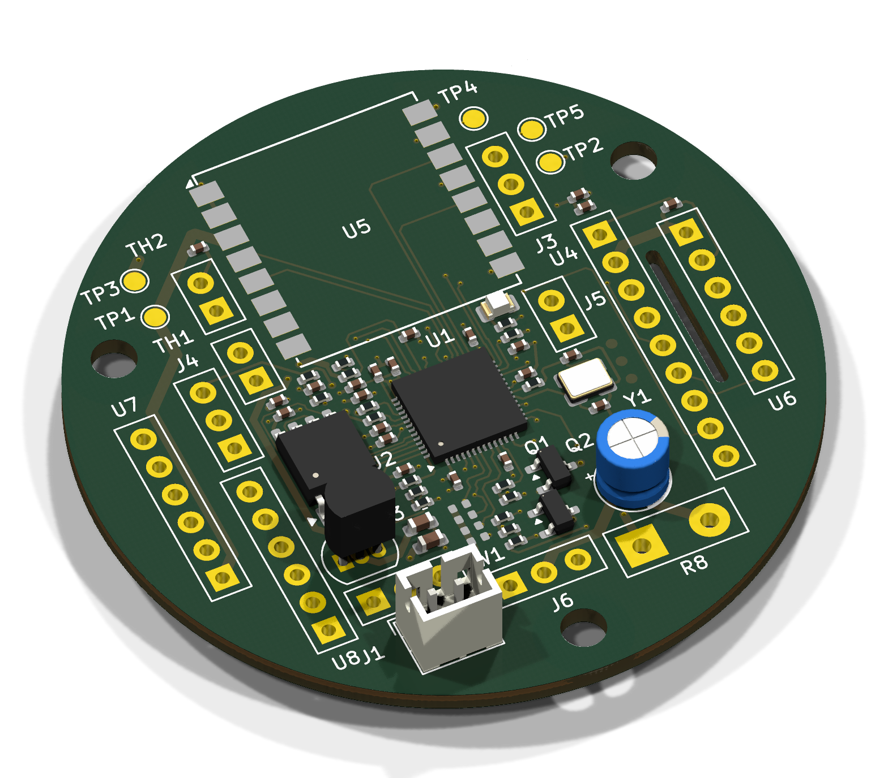
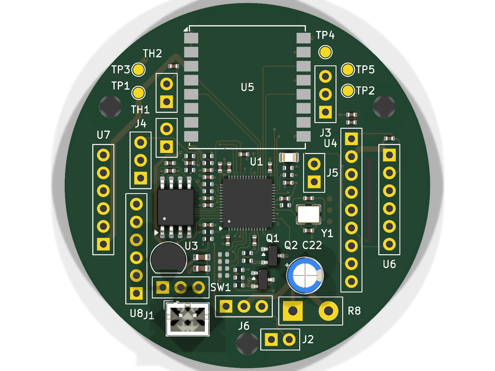
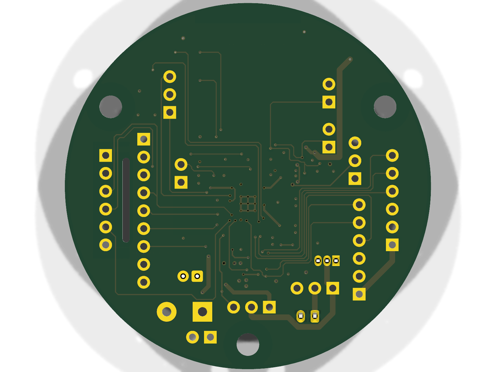
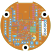
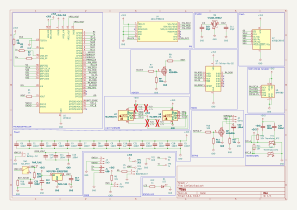
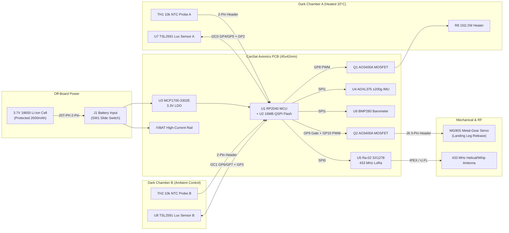

# Verticality — RP2040 CanSat Avionics & Bioluminescence Payload PCB

[](https://kicanvas.org/?repo=https://github.com/huzi-ctrl/Verticality/tree/main/pcb)

> **Project Summary (>100 Characters):**
> Custom 4-layer RP2040 CanSat flight computer and *Pyrocystis lunula* bioluminescence payload PCB (`45×42 mm`) featuring dual TSL2591 dark-chamber lux sensors, closed-loop PID thermal control, BMP280 barometer, ADXL375 ±200g shock IMU, MG90S servo release, and 433 MHz Ra-02 LoRa telemetry.



A custom **4-layer RP2040 flight computer and biological payload controller PCB** (`45.0 mm × 42.0 mm`) designed for **Team Verticality's CanSat mission**. In addition to primary atmospheric profiling and 433 MHz LoRa telemetry during rocket deployment and parachute descent, this board runs a dual-chamber astrobiology experiment measuring mechanical-stress and thermal effects on **bioluminescent marine dinoflagellates (*Pyrocystis lunula*)**.

---

## 1. Mission Overview & How It Works

### Primary Mission (Atmospheric Profiling & Flight Telemetry)
During rocket ascent, apogee deployment, and parachute descent (~8–10 m/s), the onboard **Raspberry Pi RP2040** (`U1`) samples:
- **Barometric Pressure & Temperature (`U6` BMP280 on `SPI1`)**: Computes real-time barometric altitude and vertical descent rate at 5 Hz.
- **High-G 3-Axis Shock & Acceleration (`U4` ADXL375 ±200g on `SPI1`)**: Captures launch acceleration, deployment shock, and landing impact (with hardware shock interrupt routed to `GP22`).
- **433 MHz LoRa Downlink (`U5` Ai-Thinker Ra-02 / SX1278 on `SPI0`)**: Transmits live CSV telemetry packets (`SF9, BW 125 kHz, CR 4/5`) to the ground station while logging full-rate telemetry to the onboard **16 MB Winbond W25Q128JVS QSPI NOR Flash (`U2`)**.

### Secondary Mission (*Pyrocystis lunula* Bioluminescence & Thermal Regulation)
*Pyrocystis lunula* produces blue-green bioluminescence (~474 nm) in response to shear/mechanical stress (launch acceleration, parachute opening, and landing impact), but its enzymatic luciferin-luciferase reaction is sensitive to cold upper-altitude temperatures:
1. **Chamber A (Thermally Regulated Experimental Chamber)**:
   - Heated by a **15 Ω 2W metal-oxide power resistor (`R8`)** switched directly from raw `/VBAT` via a low-$R_{DS(\text{on})}$ **AO3400A N-channel MOSFET (`Q1`)** driven by a 1 kHz PWM PID loop on `GP8`.
   - Closed-loop temperature feedback is provided by a **10 kΩ NTC thermistor probe (`TH1`)** on `GP27 / ADC1`, maintaining the culture at **20.0 °C**.
   - Bioluminescence photon flux inside the dark chamber is measured by an ultra-high-sensitivity **AMS TSL2591 digital light sensor (`U7`, 9876× gain)** on `I2C0` (`GP4`/`GP5`, interrupt on `GP2`).
2. **Chamber B (Unheated Ambient Control Chamber)**:
   - Identical optical geometry and *Pyrocystis lunula* culture volume, monitored by a second **10 kΩ NTC thermistor (`TH2`)** on `GP28 / ADC2` and a second **TSL2591 sensor (`U8`)** on `I2C1` (`GP6`/`GP7`, interrupt on `GP3`) without active heating.
3. **Post-Landing Deployment (`J6` MG90S Servo)**:
   - Upon touchdown detection (barometric altitude stabilization + `ADXL375` shock interrupt), the RP2040 enables low-side MOSFET **`Q2` (`AO3400A` on `GP9`)** and drives a 50 Hz PWM signal (`GP10`) to the **MG90S metal-gear micro servo (`J6`)** to actuate the post-landing mechanical release, then cuts servo power to eliminate idle current draw during extended post-landing bioluminescence monitoring.

---

## 2. PCB Design & 4-Layer Stackup

| Top 3D Render (`F.Cu`) | Bottom 3D Render (`B.Cu`) |
| :---: | :---: |
|  |  |

### Stackup & Layout Highlights
- **Dimensions**: `45.0 mm × 42.0 mm` (fits horizontally inside the standard 66 mm diameter CanSat cylindrical structural bus with clearance for wiring and standoffs).
- **4-Layer Stackup**:
  - **`F.Cu` (Layer 1)**: High-speed QSPI (`U1` ↔ `U2`), 12 MHz crystal (`Y1`), SMD decoupling network, and primary component placement.
  - **`In1.Cu` (Layer 2)**: Solid uninterrupted **`GND` reference plane** (`GND_PLANE_IN1`) providing low-inductance return paths for SPI, I2C, USB, and the 433 MHz LoRa RF module.
  - **`In2.Cu` (Layer 3)**: Solid **`+3V3` power plane** (`+3V3_PLANE_IN2`) fed by the `MCP1700-3302E` 3.3 V LDO (`U3`).
  - **`B.Cu` (Layer 4)**: Mitered $45^\circ$ orthogonal signal buses and high-current `/VBAT` distribution (`0.6 mm` traces) for the heater (`R8`) and servo (`J6`).
- **RF & Clock Integrity**:
  - Dedicated copper keepout zones under the **12 MHz SMD crystal (`Y1`)** on `F.Cu` and under the **Ai-Thinker Ra-02 (`U5`) antenna region** across all layers.
  - Every `100 nF` decoupling capacitor (`C1`–`C8`, `C11`, `C13`, `C14`, `C16`, `C18`, `C19`, `C21`) is placed within **1.3 mm – 2.8 mm** of its target IC power pin.
  - All trace corners use **$45^\circ$ mitered bends** and pass KiCad 10.0 DRC with **0 unconnected items** and **0 clearance/routing violations**.

### 2D Layout (`F.Cu`, `B.Cu`, `F.SilkS`, `Edge.Cuts`)


---

## 3. Schematic & System Wiring

### Full Circuit Schematic
> 📄 **[Click here to open the full vector PDF schematic (`schematic.pdf`)](schematic.pdf)**



### Off-Board Wiring Diagram


### RP2040 (`U1`) Complete Pinout Table

| RP2040 Pin | GPIO / Function | Schematic Net | Connected Component & Function |
| :--- | :--- | :--- | :--- |
| Pin 2 | `GP0` (`UART0_TX`) | `/RX` | `TP4` Debug UART TX output |
| Pin 3 | `GP1` (`UART0_RX`) | `/TX` | `TP5` Debug UART RX input |
| Pin 4 | `GP2` | `/INT_A` | `U7` TSL2591 (Chamber A) Interrupt |
| Pin 5 | `GP3` | `/INT_B` | `U8` TSL2591 (Chamber B) Interrupt |
| Pin 6 | `GP4` (`I2C0_SDA`) | `/SDA0` | `U7` TSL2591 (Chamber A) SDA (`R18` 4.7 kΩ pull-up) |
| Pin 7 | `GP5` (`I2C0_SCL`) | `/SCL0` | `U7` TSL2591 (Chamber A) SCL (`R19` 4.7 kΩ pull-up) |
| Pin 8 | `GP6` (`I2C1_SDA`) | `/SDA1` | `U8` TSL2591 (Chamber B) SDA (`R21` 4.7 kΩ pull-up) |
| Pin 9 | `GP7` (`I2C1_SCL`) | `/SCL1` | `U8` TSL2591 (Chamber B) SCL (`R20` 4.7 kΩ pull-up) |
| Pin 11 | `GP8` (`PWM4_A`) | `/HEATER` | `Q1` (`AO3400A`) Gate via `R7` (`100 Ω`) → `R8` (`15 Ω 2W` Heater) |
| Pin 12 | `GP9` | `/SERVO_P` | `Q2` (`AO3400A`) Gate via `R10` (`100 Ω`) → `J6.1` Servo Low-Side Power Switch |
| Pin 13 | `GP10` (`PWM5_A`) | `/SERVO_S` | `J6.3` MG90S Servo 50 Hz PWM Signal (`R17` 100 kΩ pull-down) |
| Pin 14 | `GP11` | `/PRESS_CS` | `U6` BMP280 Barometer SPI1 Chip Select |
| Pin 15 | `GP12` (`SPI1_RX`) | `/IMU_MISO` | `U4` ADXL375 & `U6` BMP280 SPI1 MISO |
| Pin 16 | `GP13` | `/IMU_CS` | `U4` ADXL375 Accelerometer SPI1 Chip Select |
| Pin 17 | `GP14` (`SPI1_SCK`) | `/IMU_SCLK` | `U4` ADXL375 & `U6` BMP280 SPI1 Clock |
| Pin 18 | `GP15` (`SPI1_TX`) | `/IMU_MOSI` | `U4` ADXL375 & `U6` BMP280 SPI1 MOSI |
| Pin 27 | `GP16` (`SPI0_RX`) | `/RA_MISO` | `U5` Ai-Thinker Ra-02 (`SX1278`) LoRa SPI0 MISO |
| Pin 28 | `GP17` (`SPI0_CSn`) | `/RA_CS` | `U5` Ai-Thinker Ra-02 (`SX1278`) LoRa SPI0 NSS (`R6` 10 kΩ pull-up) |
| Pin 29 | `GP18` (`SPI0_SCK`) | `/RA_SCLK` | `U5` Ai-Thinker Ra-02 (`SX1278`) LoRa SPI0 SCK |
| Pin 30 | `GP19` (`SPI0_TX`) | `/RA_MOSI` | `U5` Ai-Thinker Ra-02 (`SX1278`) LoRa SPI0 MOSI |
| Pin 31 | `GP20` | `/RA_RESET` | `U5` Ai-Thinker Ra-02 (`SX1278`) LoRa Hardware Reset |
| Pin 32 | `GP21` | `/RA_DIO0` | `U5` Ai-Thinker Ra-02 (`SX1278`) LoRa `DIO0` TX/RX Done IRQ |
| Pin 34 | `GP22` | `/IMU_INT1` | `U4` ADXL375 `INT1` High-G Shock / Touchdown Interrupt |
| Pin 37 | `GP25` | `/LED` | `D1` Green Status LED via `R12` (`1 kΩ`) |
| Pin 38 | `GP26 / ADC0` | `/BATT_SENSE` | Battery Voltage Sense (`R15`/`R16` `100 kΩ / 100 kΩ` 2:1 divider + `C25` `100 nF`) |
| Pin 39 | `GP27 / ADC1` | `/NTC_A` | `TH1` Chamber A `10 kΩ` NTC Thermistor (`R13` `10 kΩ` pull-up + `C23` `100 nF`) |
| Pin 40 | `GP28 / ADC2` | `/NTC_B` | `TH2` Chamber B `10 kΩ` NTC Thermistor (`R14` `10 kΩ` pull-up + `C24` `100 nF`) |
| Pins 46–47 | `USB_DM` / `USB_DP` | `/D-`, `/D+` | `J4` USB Header via `R3`/`R4` (`27 Ω` series termination) |
| Pins 51–56 | `QSPI_SD0..3`, `CLK`, `SS` | `/SD0..3`, `/CLK`, `/SS` | `U2` W25Q128JVS 16 MB QSPI Flash + `J2` `BOOTSEL` Header |

---

## 4. Firmware & Usage Instructions

All flight and ground-station software is located in the [`firmware/`](firmware/) directory:
- **[`firmware/main.py`](firmware/main.py)**: Complete RP2040 MicroPython flight state machine (`PREFLIGHT` → `ASCENT` → `DESCENT` → `DEPLOY` → `BIOLUM`), Chamber A PID thermal controller, flash CSV logger (`flight_log.csv`), and 433 MHz LoRa telemetry transmitter.
- **[`firmware/sensors.py`](firmware/sensors.py)**: Hardware drivers for `BMP280` (`SPI1`), `ADXL375` (`SPI1` + shock interrupt), `TSL2591` (`I2C0`/`I2C1` at `9876x` bioluminescence gain), Steinhart-Hart `10k` NTC conversion, and Li-Ion battery voltage monitoring.
- **[`firmware/sx1278.py`](firmware/sx1278.py)**: Register-level SPI driver for the Ai-Thinker `Ra-02` (`Semtech SX1278`) 433 MHz LoRa transceiver.
- **[`firmware/ground_station.py`](firmware/ground_station.py)**: Ground-station receiver script that listens continuously at `433.0 MHz`, appends `RSSI` and `SNR` to each received CSV frame, and streams over USB serial.

### Flashing the Board
1. Bridge **`J2` (`BOOTSEL`)** with a jumper while connecting **`J4` (USB)** to a computer (or toggle **`J5` (`RUN`)** while `J2` is shorted).
2. The RP2040 mounts as `RPI-RP2` USB Mass Storage. Copy the latest **MicroPython UF2 for RP2040** onto the drive.
3. Upload `firmware/sensors.py`, `firmware/sx1278.py`, and `firmware/main.py` using `mpremote` or Thonny:
   ```bash
   mpremote cp firmware/sensors.py :sensors.py
   mpremote cp firmware/sx1278.py :sx1278.py
   mpremote cp firmware/main.py :main.py
   mpremote reset
   ```

---

## 5. Repository Structure & Manufacturing Files

```text
├── CanSat.kicad_pro              # KiCad 10 Project File
├── CanSat.kicad_sch              # Complete Schematic Source
├── CanSat.kicad_pcb              # 4-Layer Routed &DRC-Verified PCB Layout
├── CanSat.kicad_dru              # Custom Design Rules (JLCPCB 4-Layer Constraints)
├── gerbers.zip                   # Ready-to-order JLCPCB 4-Layer Gerber + Excellon Drill Archive
├── schematic.pdf                 # Vector PDF Schematic Export
├── bom.csv                       # Full Bill of Materials with Direct Supplier Links
├── production/
│   ├── gerbers.zip               # Manufacturing Gerber + Drill Archive
│   ├── bom_jlcpcb.csv            # JLCPCB SMT Assembly BOM with LCSC Part Numbers
│   └── positions_jlcpcb.csv      # JLCPCB Pick-and-Place Component Placement (CPL)
├── firmware/
│   ├── main.py                   # RP2040 Flight State Machine & Thermal PID Controller
│   ├── sensors.py                # BMP280, ADXL375, TSL2591, and NTC Sensor Drivers
│   ├── sx1278.py                 # Ai-Thinker Ra-02 (SX1278) 433 MHz LoRa Driver
│   └── ground_station.py         # Ground Station Telemetry Receiver
└── images/
    ├── pcb_angled_3d.png         # 3D Angled Raytraced PCB Render
    ├── pcb_top_3d.png            # 3D Top Raytraced PCB Render
    ├── pcb_bottom_3d.png         # 3D Bottom Raytraced PCB Render
    ├── pcb_layout.svg            # 2D PCB Vector Layout
    └── CanSat.svg                # Schematic Vector Diagram
```

---

## 6. Bill of Materials (BOM)

The full machine-readable BOM is also available in [`bom.csv`](bom.csv) and [`production/bom_jlcpcb.csv`](production/bom_jlcpcb.csv).

| Reference | Qty | Component | Value / Specification | Footprint | Subsystem | Unit (EUR) | Total (EUR) | Direct Link |
| :--- | :---: | :--- | :--- | :--- | :--- | :---: | :---: | :--- |
| `U1` | 1 | Raspberry Pi RP2040 MCU | Dual-core Cortex-M0+ 133 MHz | `QFN-56-1EP` (7×7 mm) | OBC Core | €0.80 | €0.80 | [DigiKey](https://www.digikey.ie/en/products/detail/raspberry-pi/SC0914-13/14306009) |
| `U2` | 1 | Winbond W25Q128JVSIQ | 16 MB (128 Mbit) QSPI NOR Flash | `SOIC-8` (5.23×5.23 mm) | OBC Core | €1.35 | €1.35 | [DigiKey](https://www.digikey.ie/en/products/detail/winbond-electronics/W25Q128JVSIQ/5803943) |
| `Y1` | 1 | 12 MHz SMD Crystal | `ABM8-12.000MHZ-B2-T` (±20 ppm) | `SMD 3225-4Pin` | OBC Core | €0.45 | €0.45 | [DigiKey](https://www.digikey.ie/en/products/detail/abracon-llc/ABM8-12-000MHZ-B2-T/1237080) |
| `U3` | 1 | MCP1700-3302E-TO | 3.3 V 250 mA Low-$I_Q$ LDO | `TO-92-3` | Power | €0.48 | €0.48 | [DigiKey](https://www.digikey.ie/en/products/detail/microchip-technology/MCP1700-3302E-TO/652677) |
| `U5` | 1 | Ai-Thinker Ra-02 (SX1278) | 433 MHz SPI LoRa Transceiver | Castellated 16-Pin SMD | Comms | €3.50 | €3.50 | [AliExpress](https://www.aliexpress.com/w/wholesale-Ra-02-SX1278-433MHz.html) |
| `U6` | 1 | BMP280 Barometer Module | Digital Barometric Pressure/Temp | 6-Pin 2.54 mm Header | Avionics | €1.80 | €1.80 | [AliExpress](https://www.aliexpress.com/w/wholesale-BMP280-3.3V-module.html) |
| `U4` | 1 | ADXL375 High-G IMU Module | ±200g 3-Axis SPI Accelerometer | 8-Pin 2.54 mm Header | Avionics | €5.50 | €5.50 | [AliExpress](https://www.aliexpress.com/w/wholesale-ADXL375-module.html) |
| `U7`, `U8` | 2 | TSL25911FN Light Sensor | High-Sensitivity Lux Sensor (I2C) | 6-Pin 2.54 mm Header | Bioluminescence | €4.00 | €8.00 | [AliExpress](https://www.aliexpress.com/w/wholesale-TSL2591-module.html) |
| `TH1`, `TH2` | 2 | 10 kΩ NTC Thermistor Probe | Waterproof 10 kΩ 1% ($B=3950$) | 2-Pin 2.54 mm Header | Thermal Sense | €1.25 | €2.50 | [AliExpress](https://www.aliexpress.com/w/wholesale-10k-NTC-3950-probe.html) |
| `R8` | 1 | 15 Ω 2W Power Resistor | 15 Ω 2W Flameproof Metal Oxide | Axial Through-Hole | Chamber A Heater | €0.35 | €0.35 | [DigiKey](https://www.digikey.ie/en/products/detail/stackpole-electronics-inc/RSF2JT15R0/1706233) |
| `Q1`, `Q2` | 2 | AO3400A N-Ch MOSFET | 30 V 5.7 A Logic-Level MOSFET | `SOT-23-3` | Heater & Servo Switch | €0.25 | €0.50 | [DigiKey](https://www.digikey.ie/en/products/detail/alpha-omega-semiconductor-inc/AO3400A/1855773) |
| `C22` | 1 | 100 µF Electrolytic Cap | 100 µF 16 V Radial Bulk Cap | Radial D5.0 mm P2.0 mm | Servo Bulk Cap | €0.20 | €0.20 | [DigiKey](https://www.digikey.ie/en/products/detail/nichicon/UVR1C101MDD/588816) |
| `C1`–`C8`, `C11`, `C13`, `C14`, `C16`, `C18`, `C19`, `C21`, `C23`–`C25` | 18 | 100 nF Ceramic Capacitor | 100 nF 16 V X7R | `0402` | Decoupling & Filtering | €0.03 | €0.54 | [DigiKey](https://www.digikey.ie/en/products/detail/samsung-electro-mechanics/CL05B104KO5NNNC/3886661) |
| `C12`, `C17` | 2 | 1 µF Ceramic Capacitor | 1 µF 16 V X5R | `0402` | LDO Stability | €0.05 | €0.10 | [DigiKey](https://www.digikey.ie/en/products/detail/samsung-electro-mechanics/CL05A105KO5NNNC/3886694) |
| `C15`, `C20` | 2 | 10 µF Ceramic Capacitor | 10 µF 16 V X5R | `0805` | RP2040 & LoRa Bulk | €0.08 | €0.16 | [DigiKey](https://www.digikey.ie/en/products/detail/samsung-electro-mechanics/CL21A106KOQNNNE/3886729) |
| `C9`, `C10` | 2 | 15 pF Ceramic Capacitor | 15 pF 50 V C0G/NP0 | `0402` | Crystal Load Caps | €0.03 | €0.06 | [DigiKey](https://www.digikey.ie/en/products/detail/yageo/CC0402JRNPO9BN150/302798) |
| `R3`, `R4` | 2 | 27 Ω Resistor | 27 Ω 1% 1/16 W | `0402` | USB Series Term | €0.02 | €0.04 | [DigiKey](https://www.digikey.ie/en/products/detail/yageo/RC0402FR-0727RL/726546) |
| `R7`, `R10` | 2 | 100 Ω Resistor | 100 Ω 1% 1/16 W | `0402` | MOSFET Gate Drive | €0.02 | €0.04 | [DigiKey](https://www.digikey.ie/en/products/detail/yageo/RC0402FR-07100RL/726513) |
| `R5`, `R12` | 2 | 1 kΩ Resistor | 1 kΩ 1% 1/16 W | `0402` | XOUT & LED Limit | €0.02 | €0.04 | [DigiKey](https://www.digikey.ie/en/products/detail/yageo/RC0402FR-071KL/726518) |
| `R18`–`R21` | 4 | 4.7 kΩ Resistor | 4.7 kΩ 1% 1/16 W | `0402` | I2C0 & I2C1 Pull-Ups | €0.02 | €0.08 | [DigiKey](https://www.digikey.ie/en/products/detail/yageo/RC0402FR-074K7L/726595) |
| `R1`, `R2`, `R6`, `R13`, `R14` | 5 | 10 kΩ Resistor | 10 kΩ 1% 1/16 W | `0402` | Pull-Ups & NTC Bias | €0.02 | €0.10 | [DigiKey](https://www.digikey.ie/en/products/detail/yageo/RC0402FR-0710KL/726519) |
| `R9`, `R11`, `R15`–`R17` | 5 | 100 kΩ Resistor | 100 kΩ 1% 1/16 W | `0402` | Gate Pull-Downs & VBAT | €0.02 | €0.10 | [DigiKey](https://www.digikey.ie/en/products/detail/yageo/RC0402FR-07100KL/726514) |
| `D1` | 1 | Green SMD LED | 525 nm Status Indicator | `0603` | Status LED | €0.08 | €0.08 | [DigiKey](https://www.digikey.ie/en/products/detail/wurth-elektronik/150060GS75000/4489903) |
| `J1` | 1 | JST-PH 2-Pin Header | 2.0 mm Vertical Battery Conn | `JST_PH_B2B-PH-K` | Battery Input | €0.20 | €0.20 | [DigiKey](https://www.digikey.ie/en/products/detail/jst-sales-america-inc/B2B-PH-K-S/926611) |
| `SW1` | 1 | Slide Power Switch | Through-Hole SPDT Switch | `SW_CuK_JS202011CQN` | Master Power Switch | €0.45 | €0.45 | [DigiKey](https://www.digikey.ie/en/products/detail/c-k/JS202011CQN/1986399) |
| `J2`–`J6` | 5 | 2.54 mm Pin Headers | BOOTSEL, SWD, USB, RUN, Servo | `PinHeader_1x02..04` | Debug & Servo I/O | €0.06 | €0.31 | [AliExpress](https://www.aliexpress.com/w/wholesale-2.54mm-pin-header.html) |
| `MG90S` | 1 | MG90S Micro Servo | Metal-Gear Micro Servo (Off-Board) | Plugs into `J6` | Landing Leg Release | €2.20 | €2.20 | [AliExpress](https://www.aliexpress.com/w/wholesale-MG90S-metal-gear-servo.html) |
| `BT1` | 1 | 18650 3.7V Li-Ion Cell | 2600 mAh Protected Cell + Holder | Plugs into `J1` | Primary Battery | €4.50 | €4.50 | [AliExpress](https://www.aliexpress.com/w/wholesale-18650-battery-holder-jst.html) |
| `PCB` | 1 | 4-Layer Custom PCB | 45.0×42.0 mm 4-Layer FR4 | JLCPCB 4-Layer | Avionics & Payload PCB | €7.00 | €7.00 | [JLCPCB](https://jlcpcb.com/) |
| **Total** | | | | | | | **€41.03** | |
